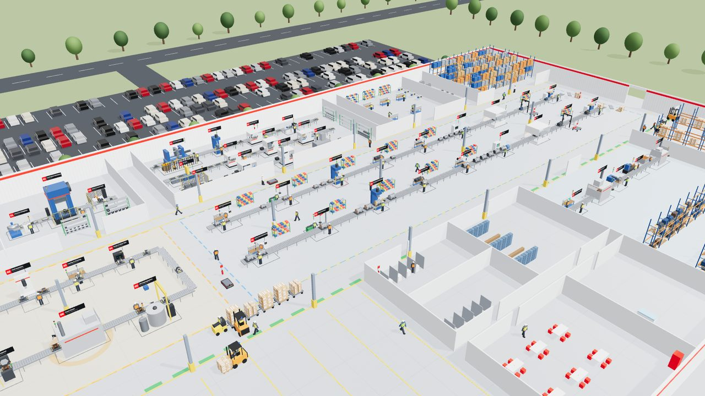
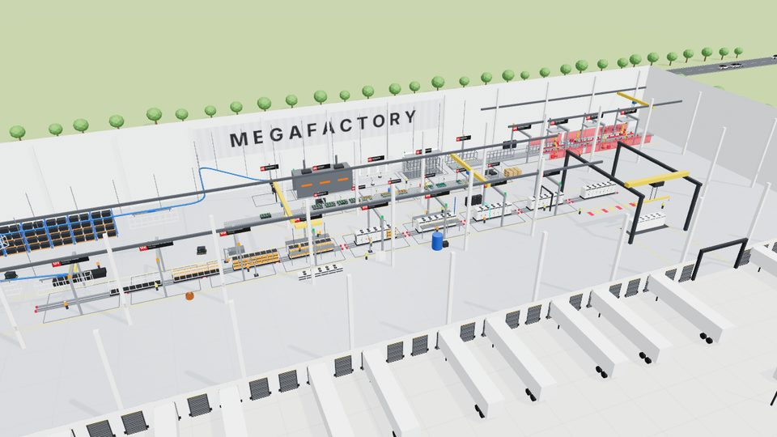

# AI Factory

Real-time 3D digital twins of manufacturing plants, built with [three.js](https://threejs.org).
There is no build step and there are no external assets: every model is generated procedurally
in the browser.

| Page | What it is |
|------|------------|
| `index.html` | Demo hub |
| `motors.html` | **Electric Motor Plant**: an AI digital twin modelled on ABB's Baldor-Reliance motor manufacturing |
| `megafactory.html` | Megafactory Line Simulator: battery packs, modelled on Tesla's Lathrop plant |
| `builder.html` | Line Builder: generic FlexSim-style objects and a layout editor |
| `capture.html` | Phone capture for the photo → 3D model pipeline (needs `node tools/capture-server.mjs`, see [Photo → 3D model](#photo--3d-model-img2threejs)) |
| `factory-builder/` | **Sim Factory Builder**: import your own layout (image, PDF or DXF), build the twin from a reusable library, draw AGV routes, staff stations and simulate (React + Vite, see [its README](factory-builder/README.md); a prebuilt copy is at `factory-builder/dist/`) |

## Run it

ES modules need to be served over HTTP (opening the files from disk won't work):

```bash
python3 -m http.server 8000
# or: npx serve .
```

Then open <http://localhost:8000>.

---

# Electric Motor Plant (AI digital twin)



A live 3D twin of an industrial electric-motor plant, modelled on ABB's Baldor-Reliance motor
manufacturing (Fort Smith, AR). The layout follows a reference floor plan with three bands:

- **North:** office & QC lab, bracket machining, maintenance shop, press shop, **East Lines 1–3**,
  sub-assembly & kitting, raw material and the **General Warehouse**.
- **Middle:** the transformer yard, **Secondary Processes** (stator winding & VPI, orange dashed
  boundary) and the **Assembly Process** area (two final-assembly lines, blue dashed boundary).
- **South:** receiving dock, tool crib, **finished-goods staging** with three shipping docks,
  restrooms, lockers, kitchen and first aid, **Warehouse 2 & Rewinding**, and FG racking.

Zone areas on the yellow plan labels are computed from the model. **Plan colours** turns on the
plan legend: rack/storage green, workstation/machine blue, raw material orange, finished goods
yellow, fire extinguishers red.

### Process

```
Press shop ──► stator cores ─► Stator winding & VPI (U-line) ──► wound stators ─┐
   (laminations) └► rotor cores ─► East Line 1 · Rotors ◄── shafts ◄── East Line 2   │
East Line 3 · Frames ──► frames ─────────────────────────────────────────────────────┤
Bracket machining ──► end brackets ──────────────────────────────────────────────────┤
                                                                                      ▼
   Line A (NEMA) / Line B (IEC): stator shrink-fit → rotor → bearings & brackets → fan & cover →
   conduit box → run test → paint → vision QC (AI) → nameplate & pack
                                                                                      │
   line-end pallets ─► forklift ─► FG racking ─► tugger train ─► staging ─► forklift ─► trucks
```

- **9 lines, 48 stations** (including the rewind service shop) with purpose-built animated machines. Examples: a straight-side
  stamping press with flywheel and ram, rotor die-casting with a molten-aluminium furnace, CNC
  lathes and machining centres with sliding doors and coolant mist, twin-flyer coil winders, a
  VPI tank with a hoist and lifting lid, cure ovens, an induction shrink-fit heater, a dynamometer
  run-test stand, a paint booth with a robot, a vision arch and a laser marker.
- **The product is built visibly.** A primer-grey finned frame receives copper windings, a shaft,
  end brackets, a fan and cover, and a conduit box. It is painted (NEMA blue or IEC grey),
  nameplated and boxed, then stacked on pallets.
- **Feeder lines** fill stock racks (each item on the racks is one part in stock). Assembly
  stations consume that stock, so a feeder that stops starves assembly.
- **Logistics:** line-end pallets go by forklift to FG racking or directly onto a 5-cart tugger
  train. The train runs the main aisle to staging, where forklifts fill the drive-in lanes and
  load trucks that back into the dock doors. There are also AGVs, a receiving forklift and reach
  trucks.
- **People:** operators at every station, walkers who head to the kitchen and restrooms at break
  times, office staff, and maintenance technicians who walk out to the machines.

### AI layer

- **Predictive maintenance.** Each machine has a health model with simulated vibration
  (mm/s RMS), temperature and power signals. Random anomalies (bearing wear, hydraulic leaks,
  heater drift…) speed up wear. The AI raises an alert with the failure mode, remaining useful
  life and confidence. You can schedule the work order, and a technician walks to the machine
  for a short planned stop. If you don't, the machine breaks down and needs a longer repair.
  **AI autopilot** schedules work orders automatically when a machine is idle or its predicted
  failure is close. The plant tracks failures avoided and downtime saved.
- **Vision QC.** A live camera feed from the inspection arch, rendered in the corner, shows
  detection boxes projected from the real part geometry (housing, conduit box, fan cover,
  bracket, shaft) and a PASS/REJECT verdict. Defects (missing bracket bolt, fan-cover dent,
  missing conduit gasket, paint run…) are visible on the 3D motor. Their rate rises as the
  upstream machine wears, so a quality problem traces back to a maintenance problem.
- **Heatmaps.** Floor overlays for utilisation, power draw, blocking and failure risk.
- **Recommendations.** Bottlenecks, quality root cause, and energy idle-waste suggestions.
- **Copilot.** Ask "why is output below plan?", "what will fail next?" and similar. Built-in
  answers are computed from live plant data and come with action buttons (schedule, show
  heatmap, enable autopilot). Optionally, paste your own Anthropic API key under
  *Connect Claude* and Claude (`claude-opus-5-5`, via the official `@anthropic-ai/sdk`) answers
  open-ended questions from a JSON snapshot of the plant. Server-side refusal fallbacks are
  enabled. The key stays in your browser's localStorage and is sent only to api.anthropic.com.

**Time scale:** 1 simulated second = 20 factory seconds. The plan is 50 motors/hour across both
lines; the run-test stations are the constraint.

**Controls:** drag/scroll to orbit and zoom. Click a station for its card, which shows live
condition monitoring, a health/vibration trend, its prediction, *Schedule maintenance* and
*Inject fault*. Space pauses. Speeds run from ½× to 8×. Camera presets: Overview, Plan
(top-down, like the drawing), Assembly, Stator & VPI, East lines, Press, Logistics, Rewinding,
Shipping, Follow motor and a looping **Tour**. `window.motorPlant` exposes the model in the
console (`motorPlant.snapshot()`, `motorPlant.advance(seconds)`, `motorPlant.jump('assembly')`).

All figures are illustrative and simulated. This demo is not affiliated with or endorsed by ABB.

---

# Megafactory Line Simulator



A real-time 3D simulation of a utility-scale battery pack production line, inspired by
Tesla's Megafactory (Lathrop, CA). Open `megafactory.html`.

  

## What's simulated

Four connected lines share one flow engine. Each station holds one unit, and units keep a minimum
spacing, so a slow or broken station leaves the stations after it with no work (**Starved**) and
makes the ones before it wait (**Blocked**). Lines hand units to each other, so a problem upstream
works its way through the plant.

```
Body in White ──► Powder Coat (overhead conveyor) ──► Pack line ──► Crane ──► Pickup pad
                                                                                  │ straddle carriers
                                                       Outbound trucks ◄── Storage lot ◄┘
                                                         ▲
Battery Modules ──► Rack warehouse ──► AGVs ─────────────┘ (4 trays per pack)
```

### Modelled on the Lathrop Megafactory video

The look and process details follow Tesla's *Meet Megafactory* video of the Lathrop, CA plant:

- Bright white building with a white column grid (with grid labels like G13), polished concrete floor,
  open steel roof joists and dense LED high-bays. The roof hides when you orbit above it.
- Yellow 6-axis robots. Body-in-White welding happens inside red translucent welding-curtain cells
  with red fixtures and welders. Yellow bridge cranes with blue hoists run over the pack line and BIW.
- Paint shop on a blue overhead conveyor: a stainless wash tunnel with nozzle risers spraying water,
  and a booth lit by tall light panels.
- On the pack line, packs ride low floor rails and the work is mostly manual. Technicians build an
  orange HV busbar spine first; operators then use lift-assist arms to slide orange-faced modules
  in from both sides. Doors swing shut as they're hung, and the thermal roof has two rows of fans
  and side louvres.
- The module line has silver aluminium guarding and light curtains, and a robot with a red gripper
  places the green BMS boards.
- Takt is calibrated to the video's "1 Megapack every 68 minutes". Finished units are staged in a yard
  outside the east wall.

### Body in White (back of plant)
| # | Station | What happens |
|---|---------|--------------|
| 01 | Base Frame Weld | Robots weld roll-formed rails into the base frame |
| 02 | Side Post Weld | 14 vertical posts are welded on |
| 03 | Roof Rail Weld | Top rails close the frame into a rigid box |
| 04 | Geometry Check | Laser arch scans the frame against CAD |

### Powder Coat (overhead power-and-free conveyor)
| # | Station | What happens |
|---|---------|--------------|
| 01 | Load & Hang | Frame is lifted off the BIW conveyor onto a carrier |
| 02 | Pre-treatment Wash | Degrease and conversion coat (spray mist) |
| 03 | Powder Booth | Spray robots coat the frame white |
| 04 | Cure Oven | Powder cures at ~200 °C (frame glows while inside) |
| 05 | Cool & Inspect | Fans cool the frame, then it rides the rail across the plant |

The rail climbs over the warehouse and drops coated frames straight onto the pack line's Chassis Load station.
Frames waiting on the rail act as the buffer.

### Battery Modules
| # | Station | What happens |
|---|---------|--------------|
| 01 | Cell Intake & Test | Cells are scanned and tested; a tray is indexed onto the line |
| 02 | Cell Insertion | 144 cells loaded into twelve module carriers |
| 03 | Interconnect Weld | Laser welding to copper collector plates (sparks) |
| 04 | Adhesive & Potting | Dispensing head fills the gaps with potting compound |
| 05 | Module Lid & BMS Board | Robot with a red gripper places lids and green BMS boards |
| 06 | Module EOL Test | Isolation and BMS checks; ~3% re-tested |

Finished trays (12 modules each) go into the rack warehouse. Each crate on the racks is one tray in
stock, up to 56. When the racks are full the module line backs up. The pack line's Module Install
station takes 4 trays (48 modules) per pack and is starved if stock runs out.

### Pack line
| # | Station | What happens |
|---|---------|--------------|
| 01 | Chassis Load | Coated frame is lowered off the paint rail onto a steel skid |
| 02 | HV Busbar & Harness | Technicians build the orange HV busbar spine down the centre |
| 03 | Module Install | AGVs bring trays; lift-assist arms slide 48 modules in from both sides |
| 04 | Thermal & Inverter | Hoist sets the thermal roof with fans and power electronics |
| 05 | Enclosure & Doors | 16 doors are hung and swing shut, then the end caps go on |
| 06 | Coolant Fill | Hose drops in, coolant loop is filled and leak-checked |
| 07 | End-of-Line Test | Scanner sweeps the pack; ~6% fail and are re-tested |
| 08 | Final QA | Inspection arch, release to shipping |

A gantry crane then sets each finished pack on a pickup pad inside the building.

### Site, storage lot and outbound logistics

The site layout follows the MFTX aerial view:

- **North:** employee parking along the boulevard, with passing traffic.
- **Cars** are low-poly Model Y and Model 3 shapes in factory paint colours. The Model Y has the
  full-width light bar and black cladding; the Model 3 has slim swept headlights. Employees drive in,
  park nose-in, back out and leave. How full the lots are follows the factory clock: they fill up for
  the 6 AM day shift and thin out after 6 PM, with visitors coming and going in between.
- **West:** an office block, a second parking lot and a fenced substation yard.
- **South:** dock doors along the wall, with drop trailers backed in, and a large concrete court
  that holds the **Megapack storage lot**.

Finished packs move like this:

1. **Three tandem pairs of red straddle carriers** (six machines, styled on the units in the site
   photos) pick each pack up from the pad and carry it out through the south door. They drive
   crab-style down the lot's aisles and set it in a free slot (60 slots).
2. **Outbound flatbed trucks** arrive on the south road and stop at the loading bay. A carrier pair
   brings the oldest stored pack and lowers it onto the trailer, and the truck leaves. A pack counts
   as shipped when its truck leaves the site.
3. **Truck bookings follow stock:** more trucks come when the lot is above 40 packs, fewer when it
   drops below 12.

If the lot fills up, the pad stays occupied, the crane has to wait and the pack line backs up.

**Time scale**: 1 simulated second = 5 factory minutes. The pack line's End-of-Line test is the
plant bottleneck, giving a takt of about 68 minutes per pack, the figure quoted in the Megafactory
video. At ~3.9 MWh per pack that is roughly a 30 GWh/year run-rate before downtime. The feeder lines run a little faster, so they fill
their buffers and then wait.

## Line Builder (generic objects, FlexSim-style)

`builder.html` is a separate page for presenting any line without 3D modelling. It has a library of
generic objects: Source, Queue, Station, Conveyor, Sink, Operator, Robot, Rack, Cart, AGV, Forklift,
Table, Pallet, Tank, Fence and Zone. You place them from a JSON layout, connect them, and items
flow through:

- Stations have three styles (`bench`, `machine` for enclosed test rigs and ovens, `cell` for a
  robot behind a fence), animated operators, and a light tower: green working, amber blocked,
  red down.
- The side panel shows output, throughput, the busiest station, and each station's
  working / blocked / starved split.
- **Edit layout** opens the library and the property panel. Click an object to select it, then:
  drag to move, **R** rotate, **C** connect to the next object, **D** duplicate, **Delete** remove.
  Use Export / Import to copy a layout as JSON. Edits are kept in your browser.

A layout is a list of objects (see `layouts/pack-line.json`):

```json
{ "name": "My line", "item": { "size": [1.4, 0.55, 0.7], "color": "#eef0f2" },
  "objects": [
    { "id": "SRC", "type": "source", "x": -20, "z": 0, "interarrival": 60, "next": ["ST10"] },
    { "id": "ST10", "type": "processor", "label": "Assembly", "x": -14, "z": 0, "time": 55, "operators": 2, "next": ["C1"] },
    { "id": "C1", "type": "conveyor", "from": [-12.4, 0], "to": [-7.6, 0], "speed": 1, "next": ["SNK"] },
    { "id": "SNK", "type": "sink", "x": -5, "z": 0 },
    { "id": "AGV1", "type": "agv", "path": [[-20, -4], [0, -4], [0, -8], [-20, -8]] }
  ] }
```

Positions are in metres. `rot` is in degrees; flow runs along the object's local x axis, and
`rot: 90` points it toward +z. Times are simulated seconds. Movers (AGV, forklift, operator) follow
a `path`, either looping or back and forth with `"pingpong": true`.

## Photo → 3D model (img2threejs)

Photograph a piece of equipment on the line with your phone and get a procedural three.js model of it
in the Line Builder library. The reconstruction is done by
[img2threejs](https://github.com/img2threejs/img2threejs), an agent skill: Claude Code looks at the
photo and writes code that builds the object from primitives (no photogrammetry, no mesh files).
It runs on your computer in Claude Code, not on the phone.

```
Phone ──capture.html──► tools/capture-server.mjs ──► captures/<slug>/  (photos + size + role)
                                                          │  Claude Code: photo-to-model skill
                                                          ▼  (runs img2threejs → TypeScript factory)
builder.html ◄── models/captured/index.json ◄── tools/register-model.mjs
```

1. **Serve the repo with the capture server** (Node 18+, no dependencies):
   ```bash
   node tools/capture-server.mjs
   ```
   It prints a LAN address. Open `http://<computer-ip>:8000/capture.html` on a phone on the same Wi-Fi.
   There is no authentication, so only run it on a network you trust.
2. **Capture**: take one or more photos (front, side and three-quarter views give a much better
   model), name the object, enter its approximate size in metres (a photo alone has no scale), and
   choose **Station** (items stop there for a cycle) or **Equipment** (static prop). Uploads go to
   `captures/<slug>/`, which git ignores by default because factory photos are often confidential.
3. **Model it**: in Claude Code, in this repo, ask *"model the pending captures"* (or run
   `/photo-to-model`). The project skill in `.claude/skills/photo-to-model/` installs img2threejs if
   needed (`npx --yes img2threejs@latest install --host claude`). It then runs img2threejs's staged,
   screenshot-checked pipeline with this repo's constraints (metres, real-time budget, front facing
   +Z) and registers the result.
4. **Use it**: in `builder.html`, choose **Edit layout**. Captured models appear under **Captured**
   in the library. Any station can also switch its body to a captured model in the property panel.

In a layout, a captured station is a normal processor with a `model` field, so cycle times, faults
and blocked/starved stats all work as usual. Equipment uses the `captured` type:

```json
{ "id": "ST20", "type": "processor", "label": "Torque station", "model": "torque-station-3", "x": 0, "z": 0, "time": 55, "next": ["SNK"] },
{ "id": "CAP1", "type": "captured", "label": "Parts washer", "model": "parts-washer", "x": 4, "z": -5 }
```

`tools/register-model.mjs <slug> <factory.ts>` can also register any hand-written factory that returns a
`THREE.Group`. It strips the TypeScript with esbuild and records the name, role, size and yaw in
`models/captured/<slug>/model.json`. The builder scales each model to fit that size and stands it on
the floor. A model that fails to load shows as an orange placeholder box. Models built from one
photo are approximate: sides the camera didn't see are guessed.

## Controls

- **Drag / scroll** — orbit and zoom
- **Click a station** (in 3D or in the list) — focus the camera and open its stats card;
  inject or clear a fault from there
- **Space** — pause / resume
- **½× … 8×** — simulation speed
- **Camera presets** — Overview, Follow pack (follows a pack all the way onto its truck), Module line, Body in White, Powder coat, Crane, Storage lot, Parking, Site
- **Line tabs** in the station panel switch between the four lines; a red dot marks a line with a fault
- **Random faults** — toggle random station breakdowns

`window.megafactory` exposes `{ sim, lines, stations, moduleStock }` in the browser console for poking at the model.

## Project layout

```
index.html       demo hub
motors.html      Electric Motor Plant (AI digital twin)
megafactory.html Megafactory simulation page
builder.html     Line Builder page (generic objects + layout editor)
capture.html     phone page for photographing equipment (served by tools/capture-server.mjs)
assets/          hub preview images
src/motors/      motor plant: main.js (lines, logistics, people, UI), models.js (motors, machines,
                 people, vehicles), plant.js (building, rooms, labels, walk graph), ai.js
                 (predictive maintenance, vision QC, heatmaps, copilot), fx.js, motors.css
layouts/         example layouts for the Line Builder
models/captured/ models generated from photos, plus index.json (the registry the builder loads)
tools/           capture-server.mjs (LAN upload + static server), register-model.mjs (TS factory → builder)
.claude/skills/  photo-to-model: Claude Code skill that runs img2threejs on a capture
src/builder/     Line Builder object library, flow engine and editor; captured.js loads captured models
src/capture/     capture page script and styles
src/main.js      plant layout, shared line engine, the four lines, crane & trucks, camera, UI
src/cars.js      Model Y / Model 3 car models (instanced) and parking-lot driving
src/site.js      exterior site: roads, parking lots and cars, office, substation, docks, trailers, landscaping
src/models.js    procedural meshes: pack, frame, module tray, paint carrier, robot, lift-assist, truck, AGV, worker, straddle carrier, trailer, yard vehicles
src/style.css    HUD styles
```

All figures are illustrative; this is not affiliated with or endorsed by Tesla.
